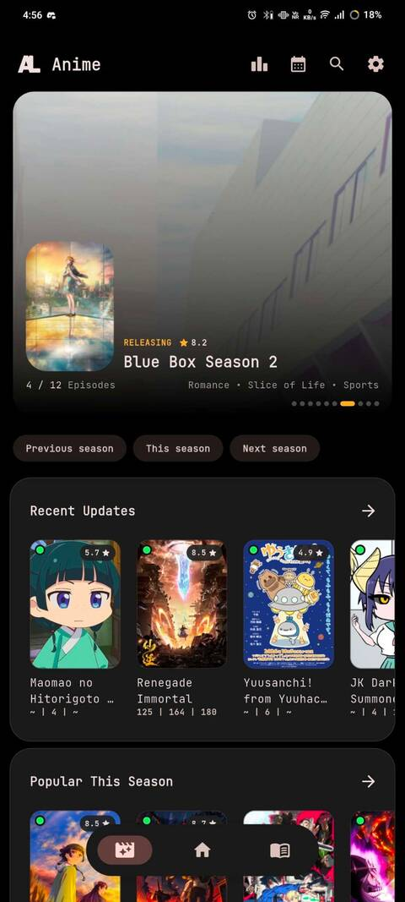
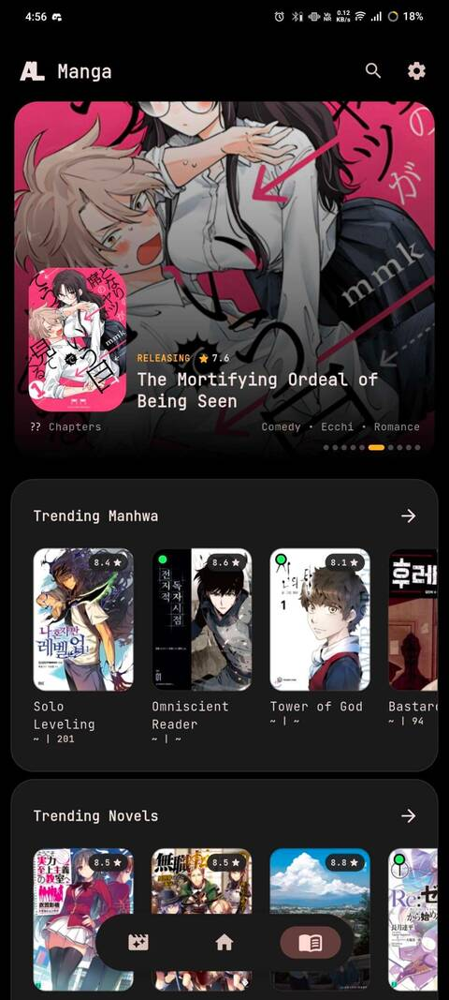
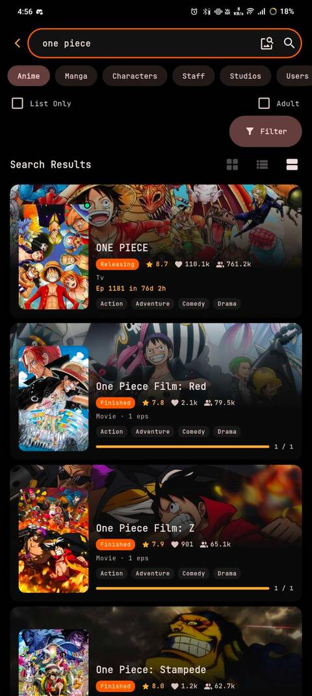
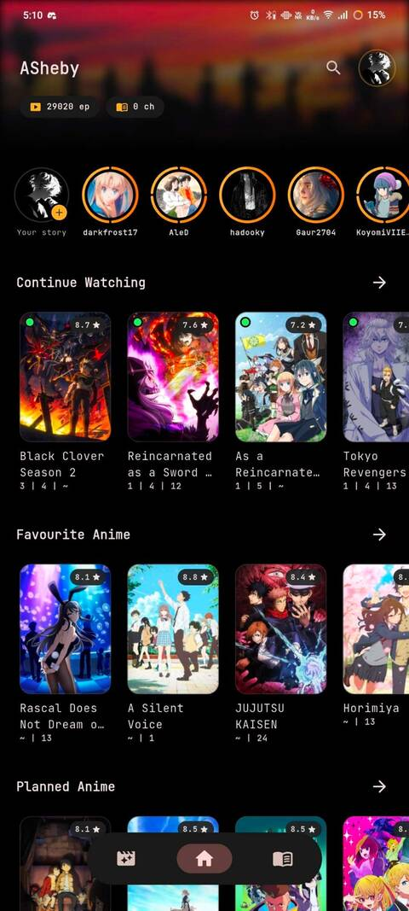
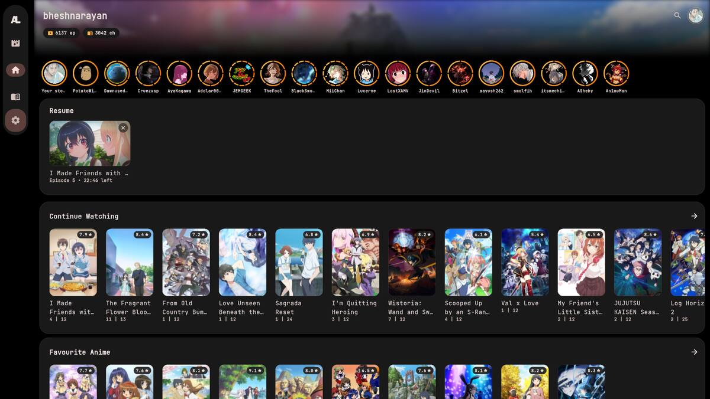
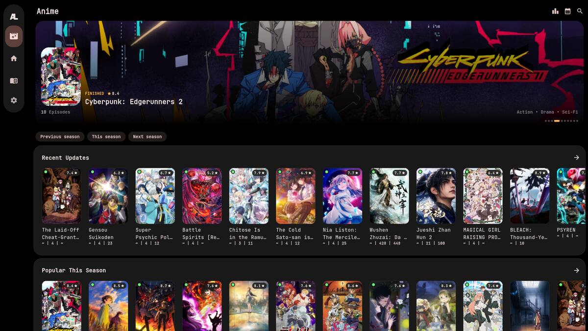
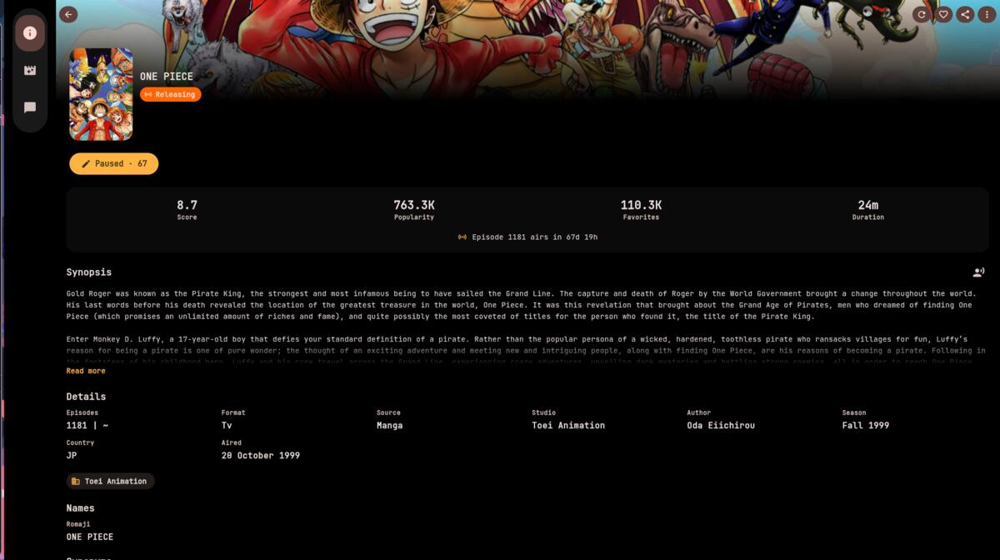

# Danzen

**Danzen** is the next app for anime and manga lists.

Danzen is a fork of [Dartotsu](https://github.com/aayush2622/Dartotsu). It takes cues from [Saikou](https://github.com/saikou-app/saikou), [Dantotsu](https://git.rebelonion.dev/rebelonion/Dantotsu/), and [ReDantotsu](https://github.com/Secozzi/ReDantotsu).

> **Tracking only.** Danzen tracks lists. It does not host video, pages, or extensions. Extensions come from other people. You are responsible for how you use the app and anything you connect to it.

## What Danzen does

- Anime, manga, and novel lists in one app
- AniList, MyAnimeList, Simkl, Kitsu, MangaBaka, and MangaUpdates
- Search, trending shelves, and discovery
- Release schedules and episode reminders
- Profiles, feeds, stories, groups, and title comments
- Themes, glass cards, and layout you can change
- Downloads queued and managed on your device
- Third-party extensions for extra sources
- Discord presence while you watch or read
- Android, Windows, Linux, macOS, and iOS

## Screenshots

### Phone

| Anime Home | Manga Home | Search | Profile |
|:---:|:---:|:---:|:---:|
|  |  |  |  |

### Desktop

| Desktop Home | Desktop Anime | Media Info |
|:---:|:---:|:---:|
|  |  |  |

## Get the app

Danzen is **not released yet**. There is no public build to install.

| | |
|---|---|
| [Download](#) | [Discord](#) |
| [View Source](#) | [Support](#) |

Live landing page: https://error-kun.github.io/danzen-page/

Application source lives in the private [demi-code/danzen](https://github.com/demi-code/danzen) repository. GitHub Pages for this site is hosted from [Error-kun/danzen-page](https://github.com/Error-kun/danzen-page).
